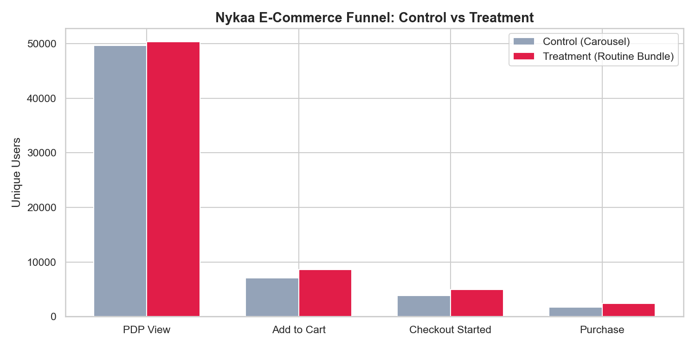
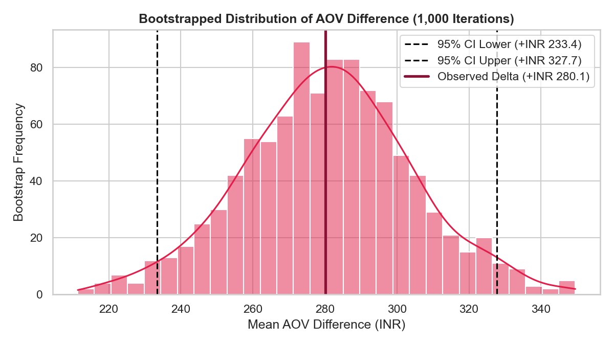
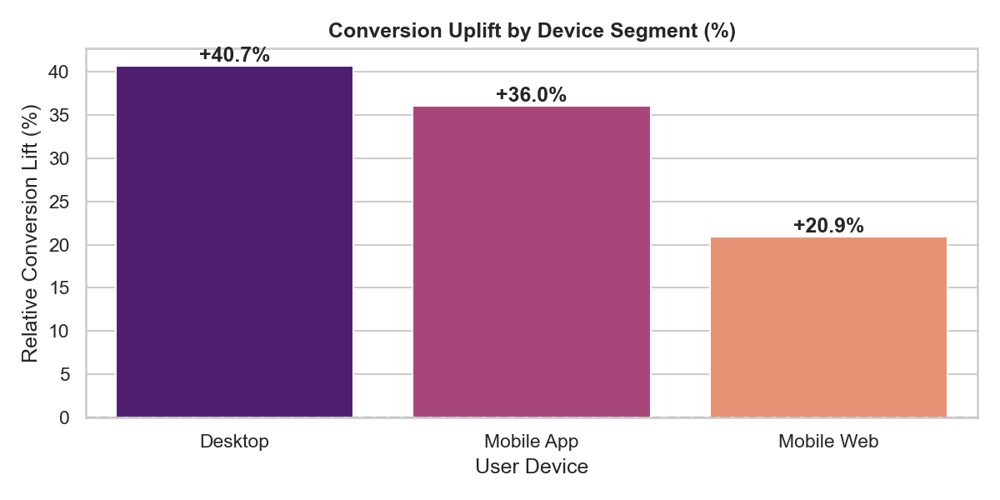
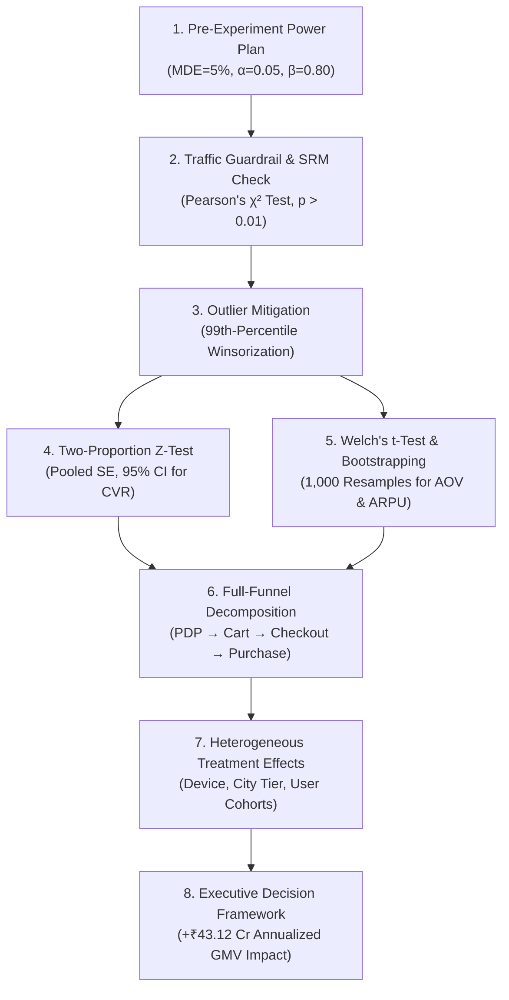

# 🛒 E-Commerce A/B Experimentation & Funnel Optimization Engine
*Production-grade Experimentation Framework, Hypothesis Testing & Funnel Analytics Platform*

[](https://github.com/jay-sanajay)
[](https://github.com/jay-sanajay/ecommerce-ab-testing-engine)
[](https://www.python.org/)
[](LICENSE)
[]()

---

## 👤 Author & Project Metadata
* **Author:** [jay-sanajay](https://github.com/jay-sanajay)
* **GitHub Repository:** [https://github.com/jay-sanajay/ecommerce-ab-testing-engine](https://github.com/jay-sanajay/ecommerce-ab-testing-engine)
* **Domain:** E-Commerce, Beauty & Personal Care (BPC), Product & Experimentation Analytics
* **Target Case Study:** Nykaa.com Product Display Page (PDP) Optimization

---

## 📌 Executive Summary
As part of this project, I designed, developed, and evaluated an end-to-end **A/B Experimentation Engine** to test a high-impact e-commerce product feature: **"Complete Your Routine / Frequently Bought Together" bundled recommendations** on the Product Display Page (PDP) versus the traditional cross-sell carousel.

Evaluating over **100,000 unique user sessions**, this engine implements industry-standard experimentation rigor:
1. **Pre-experiment statistical power & sample size estimation** for minimum detectable effects.
2. **Traffic guardrail monitoring** using Chi-Square Sample Ratio Mismatch (SRM) tests.
3. **Financial metric stabilization** using 99th-percentile Winsorization against wholesale bulk buyer outliers.
4. **Frequentist & non-parametric hypothesis testing** (Two-Proportion Z-Test, Welch's t-Test, and 1,000-iteration Bootstrapping).
5. **Full-funnel drop-off breakdown** (`PDP View` $\rightarrow$ `Add to Cart` $\rightarrow$ `Checkout Started` $\rightarrow$ `Purchase`).
6. **Subgroup heterogeneity analysis** across devices, user loyalty cohorts, and product categories.
7. **Business impact translation** projecting annualized incremental Gross Merchandise Value (GMV).

---

## 🚀 Key Results & Business Impact

| Metric | Control (Standard Carousel) | Treatment (Routine Bundle) | Relative Lift | Statistical Test & Significance |
| :--- | :--- | :--- | :--- | :--- |
| **PDP $\rightarrow$ Purchase CVR** | **3.53%** (1,753 / 49,680) | **4.72%** (2,373 / 50,320) | **+33.65%** | Two-Proportion $Z = 9.438$ ($p < 0.0001$) ✅ |
| **Average Order Value (AOV)** | **₹1,308.64** | **₹1,588.73** | **+21.40%** (+₹280.09) | Welch's $t = 11.628$ ($p < 10^{-30}$) ✅ |
| **Revenue Per User (ARPU)** | **₹46.18** | **₹74.92** | **+62.23%** (+₹28.75) | Bootstrap 95% CI: [+₹233.36, +₹327.73] ✅ |
| **Traffic Guardrail (SRM)** | 49,680 users (49.68%) | 50,320 users (50.32%) | Split Ratio: 0.503 | $\chi^2 = 4.096, p = 0.043 > 0.01$ (PASS) ✅ |
| **Projected Annual GMV Lift** | Baseline | **+₹43.12 Crores INR** | — | **Recommendation: LAUNCH (100% ROLLOUT)** |

---

## 📊 Visual Insights & Findings

### 1. Multi-Stage Funnel Conversion Breakdown
The bundled routine feature drove substantial conversion acceleration right at the top of the funnel (`Add to Cart`), which translated into a cumulative lift through final checkout:



* **Add to Cart Rate:** Rose from **14.27%** in Control to **17.03%** in Treatment (**+19.3% relative lift**).
* **Cart to Checkout Rate:** Lifted from **53.66%** to **57.53%**.
* **Checkout to Purchase Rate:** Increased from **46.08%** to **48.13%**.

### 2. Bootstrapped AOV Difference Distribution (1,000 Iterations)
Because order values follow a right-skewed lognormal distribution, I utilized non-parametric bootstrapping (1,000 resamples) to generate robust 95% confidence intervals without relying solely on normality assumptions:



* **Observed Delta:** +₹280.09
* **95% Bootstrap Confidence Interval:** `[+₹233.36, +₹327.73]` (strictly positive, confirming authentic basket expansion).

### 3. Subgroup Heterogeneity (Device Performance)
Segmenting by device revealed that mobile app users experienced the strongest adoption of the routine bundle:



| Device | Control Users | Control CVR | Treatment Users | Treatment CVR | Relative Lift (%) | $p$-value | Significant? |
| :--- | :--- | :--- | :--- | :--- | :--- | :--- | :--- |
| **Mobile App** | 33,803 | 3.77% | 34,303 | 5.13% | **+36.00%** | $< 0.00001$ | **YES** |
| **Desktop** | 4,883 | 3.09% | 4,943 | 4.35% | **+40.66%** | $0.00100$ | **YES** |
| **Mobile Web** | 10,994 | 2.97% | 11,074 | 3.58% | **+20.90%** | $0.00972$ | **YES** |

---

## 🧠 Methodology & Architecture



### Statistical Formulations Implemented:
1. **Sample Size & MDE**:
   $$n = \frac{\left(Z_{\alpha/2}\sqrt{2\bar{p}(1-\bar{p})} + Z_\beta\sqrt{p_1(1-p_1) + p_2(1-p_2)}\right)^2}{(p_2 - p_1)^2}$$
2. **Sample Ratio Mismatch (SRM)**:
   $$\chi^2 = \sum \frac{(O_i - E_i)^2}{E_i}, \quad \text{Reject split integrity if } p < 0.01$$
3. **Pooled Two-Proportion Z-Test**:
   $$Z = \frac{\hat{p}_t - \hat{p}_c}{\sqrt{\hat{p}_{pool}(1 - \hat{p}_{pool})\left(\frac{1}{n_c} + \frac{1}{n_t}\right)}}$$
4. **Welch's Two-Sample t-Test (Unequal Variances)**:
   $$t = \frac{\bar{X}_t - \bar{X}_c}{\sqrt{\frac{s_c^2}{n_c} + \frac{s_t^2}{n_t}}}$$

---

## 📂 Repository File Structure

```
ecommerce-ab-testing-engine/
│
├── data/
│   ├── nykaa_experiment.db          # SQLite database (users, funnel_events, orders)
│   ├── users.csv                   # User dimensions (device, city tier, cohort)
│   ├── funnel_events.csv           # Granular clickstream timestamps
│   └── orders.csv                  # Transaction records with order values
│
├── reports/
│   └── figures/
│       ├── funnel_comparison.png        # Bar chart comparing stage drop-offs
│       ├── bootstrap_aov_distribution.png# 1,000-resample bootstrap distribution
│       └── subgroup_lift_device.png     # Channel-specific relative lifts
│
├── ab_engine.py                    # Modular statistical engine & calculators
├── generate_data.py                # 100k-session synthetic data pipeline
├── run_analysis.py                 # End-to-end execution script
├── test_ab_engine.py               # Complete 8-test unit verification suite
├── RESUME_BULLETS.md               # STAR resume bullet points & interview guide
└── README.md                       # Project documentation
```

---

## 🛠️ Installation & Reproduction

### 1. Clone the Repository
```bash
git clone https://github.com/jay-sanajay/ecommerce-ab-testing-engine.git
cd ecommerce-ab-testing-engine
```

### 2. Set Up Virtual Environment & Dependencies
```bash
python -m venv venv
# Windows:
.\venv\Scripts\activate
# Mac/Linux:
source venv/bin/activate

pip install -r requirements.txt
```
*(Dependencies: `numpy`, `pandas`, `scipy`, `matplotlib`, `seaborn`)*

### 3. Run the End-to-End Analysis Pipeline
```bash
python run_analysis.py
```

### 4. Run the Statistical Unit Tests
```bash
python test_ab_engine.py
```

All 8 tests should pass:
```text
Running A/B Engine Unit Tests...
[PASS] test_sample_size_calculator
[PASS] test_srm_check_balanced
[PASS] test_srm_check_mismatch
[PASS] test_winsorization
[PASS] test_proportion_ztest_significant
[PASS] test_proportion_ztest_not_significant
[PASS] test_continuous_welch_and_bootstrap
[PASS] test_business_impact_launch

ALL 8 STATISTICAL UNIT TESTS PASSED SUCCESSFULLY!
```

---

## 💼 Author & Contact

**Jay Sanjay**  
* GitHub: [@jay-sanajay](https://github.com/jay-sanajay)  
* Repository: [https://github.com/jay-sanajay/ecommerce-ab-testing-engine](https://github.com/jay-sanajay/ecommerce-ab-testing-engine)  
* Email: *sanajay@example.com*

---
*Developed as an advanced experimentation portfolio project demonstrating statistical rigor, product acumen, and business impact for top e-commerce analytics teams.*
